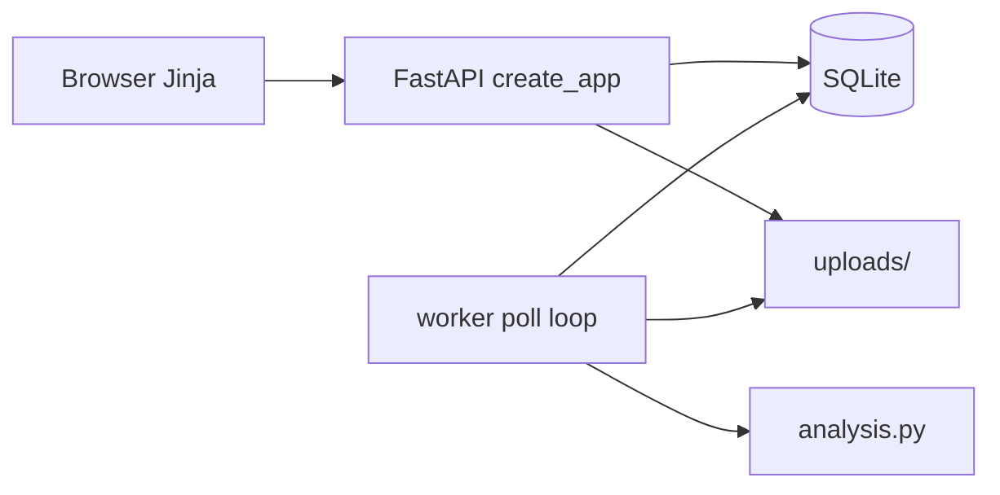

# lab-data-desk

## what it is

Register a CSV with owner, tags, and schema notes; enqueue an analysis job; browse the summary when a separate worker finishes. Demo of register -> queue -> result - not a real LIMS. 2026.

## layout

```
lab-data-desk/
  README.md
  run.sh                   # api only - worker is a second terminal
  app/
    main.py                # routes + create_app()
    db.py                  # sqlite datasets, tags, jobs, results
    analysis.py            # pandas summary
    worker.py              # poll queued jobs, write results
    templates/             # jinja pages
    static/                # css, tips.js
  sample_data/assays.csv   # synthetic (~120 rows)
  data/                    # runtime sqlite (gitignored)
  uploads/                 # runtime csv bytes (gitignored)
  tests/
  requirements.txt
  pytest.ini
  Dockerfile
  docker-compose.yml       # api + worker, shared volumes
  .dockerignore
  .github/workflows/ci.yml
```

`data/` holds the sqlite file. `uploads/` holds the registered CSVs. Both are created at runtime and shared by the api and worker (compose mounts both).

## quick start

```bash
cd lab-data-desk
python3 -m venv .venv
source .venv/bin/activate
pip install -r requirements.txt

# terminal 1 - api
./run.sh
# or: uvicorn app.main:app --reload --port 8000

# terminal 2 - worker (jobs stay queued without this)
python -m app.worker
```

Open http://127.0.0.1:8000 - register `sample_data/assays.csv`, enqueue, refresh the job until it succeeds.

Or compose:

```bash
docker compose up --build
```

## stack

Python · FastAPI · SQLite · pandas · Jinja2 · Docker · pytest

## how its wired



`POST /datasets` stores the CSV under `uploads/` with a random prefix (not the client path), writes a `datasets` row, and inserts tags into `dataset_tags`. `POST /datasets/{id}/jobs` inserts a `queued` job. The worker selects the oldest queued row, then `UPDATE ... WHERE status='queued'` to claim it (`running`). `analysis.py` runs pandas (row count, missing values, per-assay mean/std with `ddof=0`, z-score outliers). Result goes in `job_results.summary_json`; the job becomes `succeeded` or `failed` with `error_message`.

HTML and JSON share the same routes - send `Accept: application/json` (or `?format=json`) for JSON. Browser form posts get a 303 redirect so a refresh does not re-upload.

The HTTP request does not run the analysis. Queue + worker so status is real (queued / running / succeeded / failed). This is sqlite + a sleep poll, not celery.

## whats interesting

- process split: api enqueues, worker claims and analyses - same idea as a lab job queue, kept small on purpose
- schema: `datasets`, `dataset_tags` (real join table), `jobs`, `job_results`
- claim race: `UPDATE ... WHERE status='queued'` + `rowcount` check so two workers do not both take one job
- sqlite WAL so api and worker can share one db file more safely
- upload names use `secrets.token_hex` + original basename - never write using the client path alone
- summary is stable enough for pytest (sorted assays, fixed outlier rule)
- `create_app(db_path=..., uploads_dir=...)` so tests use tmp dirs and never touch the real db
- tag filter (`GET /datasets?tag=`) and `GET /jobs/{id}/export` for the raw summary json

## limitations

- sqlite + sleep poll - not a broker (no celery / redis / rabbit)
- one worker unless you run compose (api + worker) or start a second process yourself
- no auth / tenancy - local demo only
- fixed pandas summary, not a real lims or workflow engine
- uploads not scanned or encrypted at rest
- claim is good enough for this demo; not a full locking story under heavy concurrency

## tests

```bash
pytest -q
```

Register sample csv -> enqueue -> `run_once` in-process -> `succeeded` with summary. Bad columns or missing upload file -> `failed` with `error_message`. Claim race: second `claim_next_job` loses. Export returns the summary json shape (or 404 before a result). Tag filter returns only matching datasets.

## demo

```bash
./run.sh
# other terminal:
python -m app.worker
```

Open http://127.0.0.1:8000, upload `sample_data/assays.csv` with tags like `elisa, pilot`, enqueue, wait for `succeeded`. Or `docker compose up --build`.
